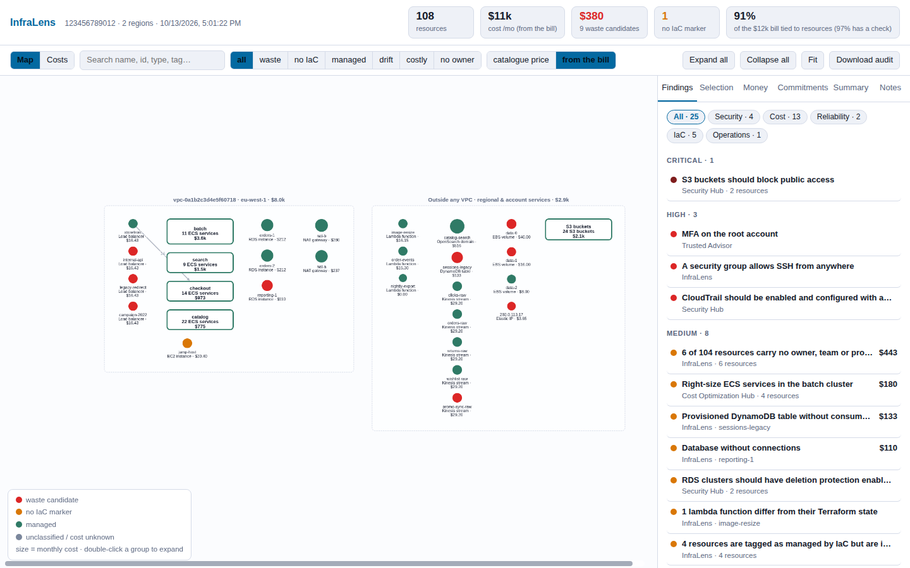
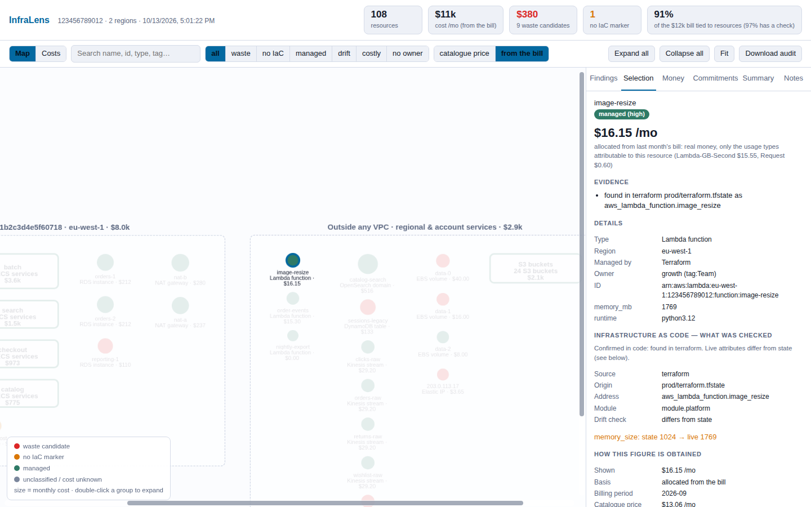
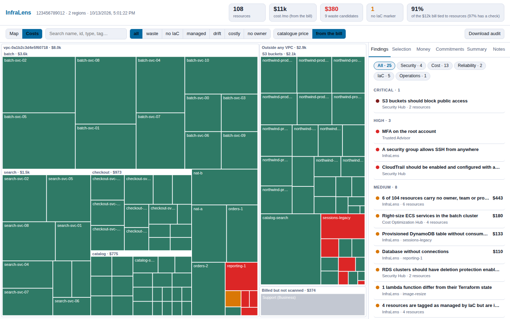
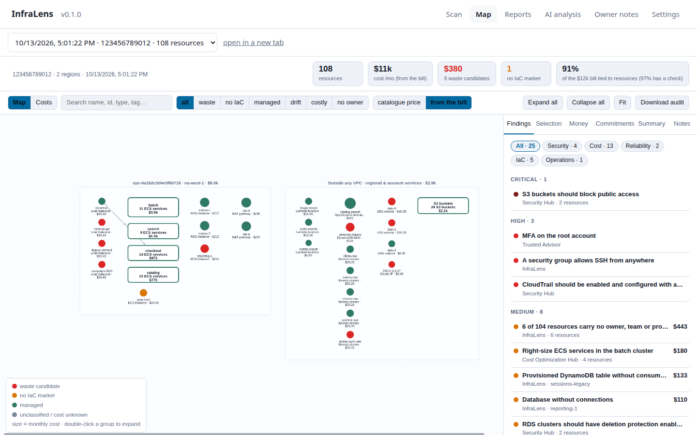
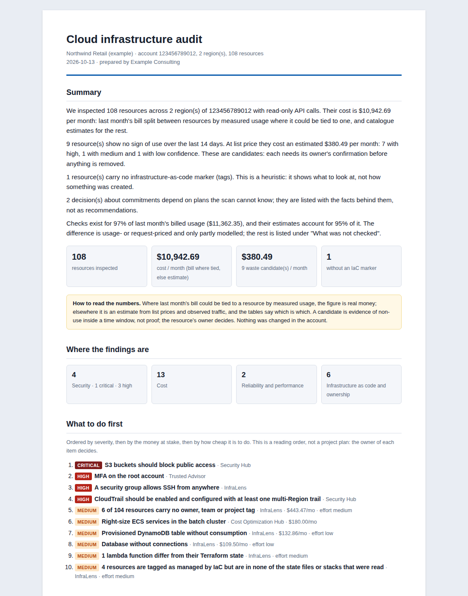
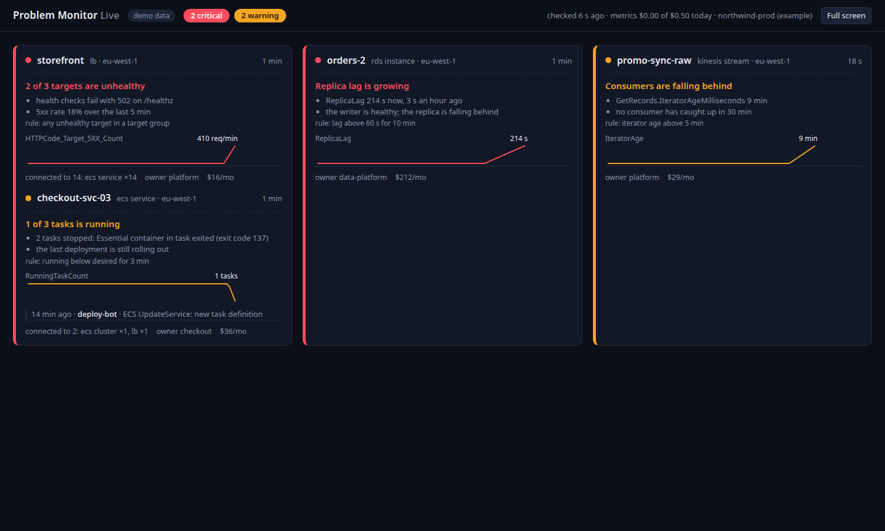

# InfraLens

A read-only AWS audit tool for engineers who have to understand an account they
did not build: what runs there, what it costs, what looks unused, what depends
on what, and what to check before removing anything.

It runs on your machine with your own credentials, never changes an account,
and produces documents you can hand to a client. It reports **evidence and
conditional suggestions**, not verdicts: it does not know your plans.

```
./infralens demo --out demo        # look at a finished example, no AWS needed
./infralens serve                  # local web app on http://127.0.0.1:8765/ : scan, map, reports, notes, model settings
./infralens shortcut --desktop     # menu entry / desktop icon that starts it (Linux), InfraLens.command (macOS)
./infralens scan --profile prod    # scan one account from the terminal
./infralens audit --profile prod --client "ACME" --out acme/   # client-ready pack
```



> **Status: 0.1, early.** It has been exercised on one real production
> account and on synthetic data, not on a wide range of accounts. Expect false
> positives on setups it has not seen, and please [report them](../../issues):
> every one of them becomes a regression test. Read-only access is enforced in
> code and tested, so the risk is a wrong finding, not a changed account.

> **Need an audit of your AWS account?** Fixed price from €900, read-only access,
> written report in 5-7 working days: [ecix.ee/audit](https://ecix.ee/audit/).

It looks at an account in three layers and joins them: **infrastructure**
(what exists, how it is connected, who owns it, whether it is in Terraform or
CloudFormation), **cost** (what each part really costs, taken from the bill
and not from a price list) and **security** (a thin layer of own checks plus
whatever AWS Security Hub, Trusted Advisor and Prowler already found). A
language model can then explain the result; it never produces numbers.

## What it looks like

| | |
|---|---|
|  |  |
| A resource: the bill-based price and how it was derived, what was compared with Terraform state, and what differs. | The same account as a treemap, priced from last month's bill. |
|  |  |
| `infralens serve`: scan, map, reports and settings in one window. | The audit document, by pillar, with what to do first. |

All screenshots are of the built-in synthetic example (`infralens demo`).

## Problem Monitor (live)

A screen for a second monitor that shows **only what is wrong, right now**:
nothing healthy is drawn, so an empty screen means quiet. Open it from the app
(`Problem Monitor`) or at `/live`; `infralens serve --monitor PROFILE` starts it
at once, and `--demo-live` shows scripted example problems without AWS.



It asks AWS cheap, read-only questions every 30-60 seconds: CloudWatch alarms
in ALARM, ECS services below their desired count or with a failed deployment
(with why tasks stopped), unhealthy load-balancer targets, RDS/Aurora in a
broken state, dead-letter queues that are not empty, and open AWS Health
issues. A problem has to persist for a few polls before it is shown, and it
needs a few clean polls to clear, so it does not flicker. Problems that touch
each other are grouped into one incident, with what they are connected to
(from your last scan), the owner and the cost.

* Everything it calls is free. Metered CloudWatch metric calls (coming) have a
  hard budget of $0.50 a day, shown on the screen, and polling slows down
  instead of overspending.
* It is not an APM: it sees AWS infrastructure state, not what happens inside
  your applications or the memory and disk of an EC2 instance.
* If it cannot see (expired credentials, an API that does not answer) it says
  so in red, instead of showing a calm screen.
* An owner note silences a live problem only if it names a rule starting with
  `live.`, for example `{"match": {"name": "orders-*", "rule": "live.rds.bad-status"},
  "note": "failover drill", "until": "2026-11-01"}`.
* `infralens policy --watch` prints the extra read-only permissions it needs.

## Install

Download a binary for Linux or macOS from the [Releases page](../../releases)
(checksums in `SHA256SUMS`), or build it from source (next section).

## Build

```
make build            # CGO_ENABLED=0 go build -trimpath -o infralens .
make test
VERSION=1.0.0 make release     # linux/macOS amd64+arm64 tarballs and SHA256SUMS in dist/
```

Pure Go, one static binary, no runtime dependencies.

## Commands

| Command | What it does |
|---|---|
| `serve` | Local web app on `127.0.0.1`: choose a profile, scan with progress, open the map, edit owner notes, set the language model, press **Generate report**. |
| `shortcut` | Create (or `--remove`) a launcher for `serve`: a menu entry and, with `--desktop`, an icon on Linux; `~/Applications/InfraLens.command` on macOS. Run it from the place where the binary will stay. |
| `llm show\|set\|test` | Choose the language model and where its key comes from (environment variable or a private file). |
| `ai SCAN.json [--ask "…"]` | A validated plain-language reading of a saved scan, or an answer to a question about it. |
| `scan` | Scan one or more profiles (`--profile a,b`, `--all-profiles`). Writes `report.html`, optional JSON, keeps history and diffs against the last scan. |
| `audit` | Scan (or `--from scan.json`) and write a pack: `audit.html` (the document, by pillar), `findings.csv`, and unless `--anonymize` the interactive `report.html` and `scan.json`. `--ai-reading` adds a model-written reading, marked as such. |
| `report SCAN.json OUT.html` | Rebuild the interactive report from a saved scan; `--context` applies owner notes. |
| `explain SCAN.json NAME` | Why a resource got its verdict, what it was based on, what the check cannot see. |
| `cleanup SCAN.json --out DIR` | Generate reviewable cleanup scripts. Nothing is run. |
| `progress OLD.json NEW.json` | Before/after document: what was resolved, what is still open, what is new. |
| `diff OLD.json NEW.json` | Text comparison of two scans. |
| `policy` | Print the minimal read-only IAM policy for the selected checks. |
| `doctor` | Check which checks will work with the credentials at hand, before the engagement. |
| `checks` | List the checks. |
| `demo`, `version` | Synthetic example; version. |

Exit codes: `0` ok, `1` error (also if one of several accounts failed), `2` usage, `3` a policy threshold was exceeded (`--fail-on-waste`, `--fail-on-new-waste`) or `doctor` found a problem.

## Safety model

* **Read-only is enforced in code.** Every SDK call passes a guard that refuses
  any operation not named `Describe*`, `List*` or `Get*` (plus the SDK's own
  token refresh and role assumption). A bug cannot change an account.
* `--api-log FILE` writes every call as JSON lines so a client can see exactly
  what ran. A scan prints `N read-only API calls, 0 blocked`.
* `infralens policy` gives the exact IAM actions needed; nothing is asked for
  that is not used. `--services` narrows it.
* History, scans and the output of `audit` are written with mode 0600/0700:
  they contain an inventory of the account.
* `--anonymize` replaces names, IDs and the account number (including inside
  evidence text) and then does **not** write the raw report or scan into the
  output directory.
* Cleanup scripts are text. By default a script prints what it would do and
  changes nothing; see below.
* Nothing leaves the machine unless you configure a language model and agree.
  The facts sent to it are findings and totals with names, account numbers,
  ARNs and e-mail shapes removed; the payload is shown first and a remote
  model needs your yes (`--yes` in scripts, a checkbox in the web app). A local
  model (Ollama on loopback) is not asked. API keys live in
  `~/.infralens/secrets.json` (mode 0600) or in an environment variable, never
  in settings, scans, reports or logs.
* The web app listens on loopback only and refuses any other address. Every
  request needs a one-time token (exchanged for a `SameSite=Strict` cookie), a
  loopback `Host` (DNS-rebinding guard), and writes need a same-origin
  `Origin` and a custom header. Pages are served with a strict CSP; the report
  may not use the network at all.
* Terraform state contains secrets. It is read only when you name it
  (`--tfstate`), only an allow-list of attributes is kept (ids, names,
  sizes), everything else is dropped in memory, and tests prove a planted
  secret never reaches a scan, a report or a prompt.

## An engagement, step by step

```
infralens policy --services rds,ec2,... > policy.json     # give this to the client
infralens doctor --profile client-audit                    # confirm access works
infralens audit --profile client-audit --client "ACME" --consultant "Me" \
        --logo logo.png --api-log acme-api.log --out acme/
$EDITOR context.json                                       # what the owner tells you
infralens audit --from acme/scan.json --context context.json --client "ACME" --out acme/
infralens cleanup acme/scan.json --context context.json --out acme/cleanup
# ... the client acts ...
infralens audit --profile client-audit --client "ACME" --out acme-2/
infralens progress acme/scan.json acme-2/scan.json --client "ACME" --out acme/progress.html
```

## What it checks

Each check is one file that registers itself. `infralens checks` lists them.

| Area | Checks | Typical verdicts |
|---|---|---|
| Compute | EC2, ECS (Fargate Spot blended), Lambda | cost from size and usage; idle functions are clutter, not savings |
| Data | RDS/Aurora, OpenSearch, Redshift, MemoryDB, ElastiCache, DynamoDB, Kinesis, S3 | no connections / no consumption in the window; Aurora readers and replication-group members are never judged idle |
| Network | NAT (traffic and processing cost), load balancers, Elastic IPs, VPC endpoints | no traffic; no targets; unassociated |
| Storage | EBS volumes, snapshots, CloudWatch log groups | unattached; orphaned; never expiring |
| Messaging, edge | SQS, Firehose, CloudFront | request/ingest cost from metrics |
| Commitments | reservations, coverage, Savings Plans | facts and conditional suggestions; never "loss" |

Waste candidates get a **blast radius** lookup: Route53 records and CloudFront
origins pointing at a balancer, route tables through a NAT, Lambda and fan-out
consumers of a stream, snapshots of a volume, cluster siblings. A dependent
lowers confidence; the lookups that ran are recorded so "none found" means
"looked".

## Layers, findings and money

Everything is a **finding** with a pillar (cost, security, reliability,
performance, IaC, operations), a source, evidence and "what this cannot see".
Sources: the tool's own checks and, when the account has them, Trusted
Advisor, Cost Optimization Hub, Compute Optimizer and Security Hub (read, not
re-implemented), plus `--prowler-json`. Duplicates are merged and a claim made
by one source is cross-checked against what the inventory shows (for example
"idle RDS" against an Aurora reader). Services that are not enabled are
listed, never enabled for you.

Each money figure carries a basis:

| Basis | Meaning |
|---|---|
| allocated | last month's Cost Explorer amount for a usage type, divided over the resources by a measured driver (hours, GB, vCPU-hours…) |
| estimated | list price from size and observed use; used where the bill cannot be tied to the resource |
| n/a | cannot be priced from the API; stated, not guessed |

The ledger lists what the bill contains and what could not be tied to a
resource, with the reason. The header states two numbers on purpose: how much
of the bill is tied to resources and how much of it has a check.

IaC coverage is exact where state is available: resources are joined to
Terraform state and CloudFormation stacks by id/ARN, and the report lists
resources outside code, state entries without a resource, resources in state
twice, and attribute drift for the types where those attributes are collected
(it says for how many of how many).

## Reading the numbers

* Where the bill cannot be tied to a resource, costs are list-price
  **estimates** from sizes, storage and observed traffic. Savings Plans and
  reservations bought elsewhere are invisible from a member account, so an
  estimate can be several times the invoice (the report offers a "by bill"
  view that apportions the invoice instead).
* "Idle" is evidence of non-use inside a window (default 14 days), not proof.
  Longer cycles are invisible. Young resources get lower confidence.
* "No IaC marker" is a tag heuristic, not proof of how something was created.
* Coverage is stated: the billed share the checks account for, and what is
  not checked.

## Language model

Optional, off until configured: `infralens llm set --provider ollama --model llama3.1`
(providers: gemini, openai, anthropic, ollama, openai-compatible, bedrock via
your AWS profile). The model writes prose around facts that were already
computed. Its output is validated: a finding id it did not receive is dropped,
and a sentence with an amount that is not in the facts is removed; the count
of removed statements is shown. It is a reading aid, not a detector.

## Owner notes: `--context`

What you know and the scan cannot:

```json
{ "notes": [
  {"match": {"service": "Amazon OpenSearch Service"},
   "note": "moving to on-prem Elastic; reservations will lapse", "until": "2027-06-30"},
  {"match": {"type": "aws_kinesis_stream", "name": "acme-feed-*"},
   "note": "low traffic by design"}
]}
```

Match on `id`, `name` (glob), `type`, `service`, `region`. An acknowledged
finding is shown with its note and is not counted. A note stops applying after
`until`; a note that matches nothing is reported.

## Cleanup scripts

One script per candidate, `NN-<type>-<name>.sh`, plus `index.csv` and a README.
A script checks the account first and then works in stages:

1. `bash NN-...sh` — dry run, prints commands (the default).
2. `DRY_RUN=0 bash NN-...sh` — **quarantine**: backup (snapshot, definition
   dump), tag, and where reversible a stop.
3. `DRY_RUN=0 STAGE=delete CONFIRM=<exact resource id> bash NN-...sh` — removal.

Each script has a `rollback` function that says how to come back, or states
plainly that it cannot be undone. Resource names are shell-quoted and comments
are stripped of control characters; the test suite runs the scripts against a
stub `aws` to prove the defaults are safe.

## What a scan costs

A scan only reads. Most calls are free; Cost Explorer requests are billed by
AWS (about $0.01 each, a scan makes a handful) and `--no-allocate` skips them.
Security Hub, Trusted Advisor and similar sources are read only if the account
already pays for them. `--api-log` records every call so a client can check.

## Thresholds

`--config thresholds.json` overrides rules (unknown keys are rejected):
`idle_window_days`, `nat_idle_bytes`, `snapshot_min_age_days`,
`kinesis_near_idle_bytes`, `log_min_cost`, `log_min_stored_gb`,
`s3_no_lifecycle_gb`.

## History and CI

Scans are kept in `~/.infralens/history/<account>/` (last 100) and each new
scan is compared with the previous one: new, gone, changed, new waste. Only
resource types covered by both scans are compared.

```
infralens scan --profile prod --fail-on-waste 500 --fail-on-new-waste 50
```

## Developing

```
go vet ./... && go test ./...
```

A new service is one file that calls `register(Scanner{...})` (see
`internal/aws/registry.go`) and an entry in `scannerActions` (the test fails
until it exists). Decision logic should be reachable through a small interface
so it can be tested with canned API responses, as in
`internal/aws/scanners_test.go`. Every false positive found in the field gets
a regression test.

## Security

See `SECURITY.md` for what the tool does and does not do, and how to report a
problem.

## Licence

Apache License 2.0 (see `LICENSE`). Components it embeds or links, and their
licences, are listed in `THIRD_PARTY.md`.

Maintained by [ECIX](https://ecix.ee/), DevSecOps consulting.
